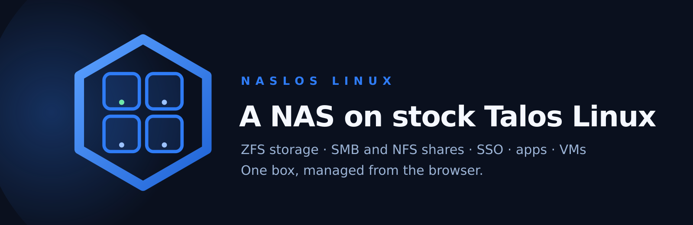

<p align="center">
  
</p>

<h1 align="center">Naslos</h1>

<p align="center">
  A NAS appliance for people who still want to upgrade their OS.<br>
  ZFS, shares, single sign-on, apps and virtual machines on <b>stock Talos Linux</b>.
</p>

<p align="center">
  <a href="https://github.com/AessemOps/Naslos-Linux/actions/workflows/ci.yml"></a>
  <a href="https://github.com/AessemOps/Naslos-Linux/releases"></a>
  <a href="LICENSE"></a>
  <a href="docs/README.md"></a>
</p>

Naslos turns one machine into a storage box you can run from a browser. The
operating system is stock [Talos Linux](https://www.talos.dev/): immutable,
API-managed, and still upgradable with `talosctl upgrade`. Everything Naslos
adds (ZFS, sharing, identity, apps, backups, monitoring) is shipped as a Helm
chart, a Kubernetes workload, or an Image Factory schematic. Nothing is forked.

## Why Naslos

- **Storage first.** Pools, datasets, zvols, snapshots, scrubs, SMART health,
  local replication, and dataset encryption, all driven from the UI or the API.
- **A real identity layer.** Authelia SSO over OpenLDAP, 2FA for admins, Samba
  password sync, per-request roles, and a hash-chained audit log.
- **Apps that route themselves.** Install from a git-backed catalog and the app
  gets a Traefik route, TLS, optional Authelia auth, and its own namespace.
- **Boring to operate.** A desktop installer, resumable install state, config
  export/import, web upgrades with rollback, and a documented recovery path.

## What you get

### Storage

- **ZFS pools and datasets.** The official `siderolabs/zfs` extension, pool
  import at boot, a topology advisor (mirror / RAIDZ1 / RAIDZ2), best-practice
  tuning (`ashift=12`, `compression=zstd`, `xattr=sa`, `acltype=posixacl`,
  `atime=off`), and discovery of pools already on disk via `zpool import`.
- **Encryption at rest.** Raw-key ZFS native encryption is created with the
  dataset: the API generates the 32-byte key into a Secret in `naslos-keys`,
  and an administrator explicitly unlocks after boot (no auto-unlock).
  Replication of an encrypted dataset is raw-only (`zfs send -w`), creates the
  replica, and unlocks it with the copied source key. Passphrase keys, raw
  Buddy sends, and in-place conversion are `[OPEN]` (see
  [docs/dataset-encryption.md](docs/dataset-encryption.md)).
- **Block volumes (zvol).** Create, list, resize, and delete zvols through a
  validated API and agent surface: growth-only resize, in-use refusals, no
  arbitrary properties. iSCSI export is `[OPEN]` (see
  [docs/iscsi.md](docs/iscsi.md)).
- **Snapshots on a schedule.** Hourly, daily, or weekly tasks per dataset with
  keep-N retention and optional recursion, named in the SMB previous-versions
  format and owned through a ZFS user property. Per-pool scrub schedules,
  "scrub now", and last/next-run results live on the pool page.
- **Replication.** Async dataset-to-dataset `zfs send`/`receive` on the same
  node: GUID-based incrementals, recursive sends, cancellable jobs, live
  progress and history, and prefix-scoped destination retention that never
  touches user snapshots.
- **Disk health.** Per-disk SMART (read-only, standby-safe) plus ZFS vdev state
  and error counters, with temperature and wear threshold alerts.

### Sharing and identity

- **SMB, NFSv4, and Time Machine.** Time Machine runs over SMB with the fruit
  VFS; AFP is not served. NFSv3 is a documented no-go for now (see
  [docs/nfsv3.md](docs/nfsv3.md)).
- **Shadow copies and auditing.** Per-share SMB previous versions come from ZFS
  snapshots, and optional `full_audit` logging records share operations.
- **Single sign-on.** Authelia over OpenLDAP with 2FA for `naslos_admins`, and
  Samba password sync so the same account works on the web and on the network
  (see [docs/identity-sso.md](docs/identity-sso.md)).
- **Roles and audit.** Roles are derived per request from trusted SSO groups
  (read-only < operator < admin, `naslos_users` baseline) by one per-route
  middleware (Phase 2 keeps every owner route admin). The audit log is
  append-only JSON Lines with a SHA-256 hash chain, fail-closed begin/end
  records, redaction, bounded retention, and admin-only query/verify/export
  routes (see [docs/rbac-audit.md](docs/rbac-audit.md)).
- **Logs and terminal.** Stream logs and open an interactive shell (`bash` by
  default; `sh`/`ash`/`zsh` where installed) in any pod from the UI.

### Apps and machines

- **App catalog.** Install from git-based chart sources (official and
  user-added) with schema-driven forms. Installs, upgrades, and uninstalls run
  as background jobs with live progress. The Installed tab shows live CPU, RAM,
  and network usage, update badges (one-click per app or **Update all**),
  and newly released upstream images for floating tags; applying an update
  forces a re-pull. The catalog refreshes in the background.
- **Exposure that fits the app.** A subdomain route, TLS with wildcard ACME
  certificates, Authelia auth, protected paths, and local-only mode are all UI
  settings. Per-app environment variables live in a Kubernetes Secret mounted
  only into the app's main container, and a base domain can opt into automatic
  per-app CNAMEs pointing at a DDNS hostname (see
  [docs/app-catalog.md](docs/app-catalog.md) and
  [docs/dynamic-dns.md](docs/dynamic-dns.md)).
- **Virtual machines.** A first-party QEMU/KVM supervisor (`rust/vmd`): VM
  datasets under `<pool>/vms/<name>` with quota equal to the declared disk,
  UEFI/BIOS with optional Secure Boot, NAT with editable port forwards, a
  browser console (noVNC over an owner-gated websocket bridge), cloud-init
  NoCloud seeds (keys only), an ISO/cloud-image library with chunked browser
  upload and SSRF-guarded URL import, and ZFS snapshots/rollback per VM (see
  [docs/virtual-machines.md](docs/virtual-machines.md)).
- **A light and dark UI.** Svelte 5 + Tailwind design tokens, self-hosted Fira
  Sans/Fira Code, a persisted theme with a no-FOUC bootstrap, a grouped
  sidebar with a responsive off-canvas drawer, shared
  modal/loading/empty/error/status components, and an axe-core WCAG 2.x scan of
  every route in both themes in the e2e suite (see
  [docs/ui-design-system.md](docs/ui-design-system.md)).

### Operations and automation

- **Dashboard and metrics.** A live metrics API (`/api/metrics`) with CPU
  detail (model, per-core load and frequency, load averages, temperature when
  the hardware exposes it), plus bounded 24 h / 7 d / 30 d reporting from an
  embedded store. No bundled metrics stack.
- **Alerts that reach you.** ntfy push, a generic JSON webhook, SMTP email, and
  RFC 5424 syslog, each with its own event routing and severity floor for
  backup, ZFS/agent health, and VM events (see
  [docs/notifications.md](docs/notifications.md)).
- **Config export and import.** Download a versioned, secret-free JSON snapshot
  of shares, snapshot/scrub and Buddy schedules, domains, DDNS entries (without
  credentials), app records, and registered app datasets. Restore goes through
  a strict dry-run plan and an explicit apply. Import never injects credentials
  or trusts exported IDs, and never deletes unrelated records (see
  [docs/api.md](docs/api.md#system-config-exportimport-fr-cfg-see-specmd-315)).
  This is application config, not the installer recovery ZIP.
- **Network changes from the UI.** Day-2 host link addressing, MTU, and DNS
  changes are applied with a machine-side `--mode=try` guard, an API watchdog,
  and a saved-config revert (see
  [docs/deployment.md](docs/deployment.md#day-2-network-changes-fr-net)).
- **MCP for AI assistants.** A Streamable HTTP endpoint at `/mcp` inside the
  API, off by default, with scoped bearer tokens (read / write / full), a
  `confirm` guard on destructive tools, audited calls, and a Settings page (see
  [docs/mcp.md](docs/mcp.md)).
- **Web upgrades.** Installer-provisioned nodes update Naslos, then Talos, then
  Kubernetes from Settings → System: verified release packs, one operation at a
  time, etcd snapshots, Helm rollback, A/B rollback detection, and a progress
  panel that survives the reboot (see
  [docs/installer-contract.md §7](docs/installer-contract.md#7-web-upgrades-fr-upd)).
- **Release engineering.** Every PR runs the full gate sweep, supply-chain scan,
  secret scan, and a Docker build of every image with a CVE gate and SBOM. A
  semantic `vX.Y.Z` tag pushes all 9 images to `ghcr.io/aessemops/naslos-*` and
  publishes the install pack with every chart image pinned by digest
  (`FR-INSTALL-13`, see [docs/deployment.md](docs/deployment.md)).

## Architecture

```
rust/agent/  Rust DaemonSet, privileged: the only process that runs zpool/zfs via chroot /host
rust/api/    Rust API: Talos/K8s/ZFS orchestration + buddyctl/buddy-receiver
rust/vmd/    Rust QEMU/KVM supervisor (naslos-vmd), privileged and QMP-controlled
ui/          SvelteKit + Tailwind: dashboard, wizards, terminal, VM console
charts/      naslos umbrella chart (api, ui, agent, vmd, openldap, samba, nfs, terminal, Traefik/Authelia)
samba/       Samba image + config
nfs/         NFS-Ganesha image + config
terminal/    web-terminal image
vmd/         naslos-vmd image (QEMU supervisor runtime)
openldap/    OpenLDAP SSO image (identity store; the workloads live in charts/naslos)
bootstrap/   schematic + ISO generator, Cilium manifest, VM + installer machine-config patches
scripts/     deploy-vm.sh, render-cilium.sh, build-install-pack.sh, audit.sh
.github/     CI + release workflows (gate sweep, image push, digest-pinned pack)
docs/        architecture, spec, API, storage, identity, catalog, installer contract, ops docs
```

The agent is the only component that runs `zpool` and `zfs`, through
`chroot /host`. The vmd supervisor is separately privileged for QEMU/KVM. The
API itself never needs host access, so Talos stays in charge of the OS and
Naslos stays in charge of the workloads.

## Install

### Desktop installer (recommended)

Download the installer for your platform from
[Naslos-Installer releases](https://github.com/AessemOps/Naslos-Installer/releases).
Boot the target machine from the Talos ISO built from the Naslos schematic,
point the wizard at the node, and it provisions the cluster end to end: storage,
certificate stack, Helm release, first admin, and a TOTP handoff, then writes a
recovery ZIP. The headless engine is in the same repo if you prefer a CLI.

### On the Naslos node

```bash
# Once per fresh node: generate the PKI, machine config, and talosconfig
make bootstrap-vm VM_IP=<node-ip>

# Install the chart, its CRDs and prerequisites
make install-vm VM_IP=<node-ip>

# Verify (the domain comes from the values-vm.yaml overlay)
kubectl -n naslos rollout status deploy/naslos-api
DOMAIN=$(sed -n 's/^domain:[[:space:]]*//p' charts/naslos/values-vm.yaml)
curl -sk "https://$DOMAIN/api/health"
```

`VM_IP` has no default. `make install-vm` also needs the
`bootstrap/vm/talosconfig` that `make bootstrap-vm` writes, plus a node already
bootstrapped with that machine config; `bootstrap-vm` prints the
`talosctl apply-config` and `talosctl bootstrap` steps. Then `install-vm`
renders `values.yaml` plus the node overlay `values-vm.yaml` and installs
`crds`, `cert-manager`, and the OVH DNS-01 webhook first. It is a clean install,
not `--reuse-values`. See [docs/deployment.md](docs/deployment.md) for the full
sequence and the required values and credentials.

### Local development

```bash
make all            # build the agent and the UI
make dev-cluster    # boot a single-node Talos dev cluster
kubectl port-forward -n naslos svc/naslos-ui 8080:80
```

## Documentation

The full set lives in [`docs/`](docs/README.md). Start with the
[normative spec](docs/spec.md), then pick a topic:

| Doc | Topic |
| --- | --- |
| [architecture](docs/architecture.md) | Design principles, system/deployment/component diagrams, data flows |
| [spec](docs/spec.md) | Normative requirements (FR/SEC/NFR IDs) and contracts |
| [api](docs/api.md) | HTTP API reference for `naslos-api` and `naslos-agent` |
| [bootstrap](docs/bootstrap.md) | Image Factory schematic and the ZFS extension |
| [storage-zfs](docs/storage-zfs.md) | Pools, datasets, zvols, snapshots, storage classes |
| [dataset-encryption](docs/dataset-encryption.md) | Key custody, boot unlock, encrypted send, migration (FR-ENC) |
| [iscsi](docs/iscsi.md) / [nvmeof](docs/nvmeof.md) | iSCSI and NVMe-oF design spikes (go/no-go) |
| [identity-sso](docs/identity-sso.md) | Authelia + OpenLDAP + Samba single sign-on |
| [external-directory](docs/external-directory.md) | Optional external LDAP source (FR-EXT) |
| [rbac-audit](docs/rbac-audit.md) | Role model and append-only audit log |
| [shares](docs/shares.md) / [acl](docs/acl.md) | SMB, NFS, Time Machine, and ACL decisions |
| [app-catalog](docs/app-catalog.md) | Catalog, schema forms, Helm lifecycle, exposure |
| [datasets-isolation](docs/datasets-isolation.md) | Isolating installed apps from the datasets root |
| [virtual-machines](docs/virtual-machines.md) | QEMU supervisor, networking, console, snapshots |
| [buddy-backup](docs/buddy-backup.md) | Owner-to-owner encrypted backup: enrollment, verify, restore |
| [monitoring](docs/monitoring.md) / [reporting](docs/reporting.md) | Live metrics and bounded history |
| [notifications](docs/notifications.md) | ntfy, webhook, SMTP, and syslog channels |
| [deployment](docs/deployment.md) | Prerequisites, Make targets, Helm values |
| [installer-contract](docs/installer-contract.md) | Install pack format and installer interfaces |
| [operations](docs/operations.md) | Backups, restore, troubleshooting |
| [development](docs/development.md) | Layout, builds, extending the catalog |
| [ui-design-system](docs/ui-design-system.md) | Tokens, shell, shared components, forms/tables, a11y checklist |

Audit reports, remediation plans, and archived design notes are indexed at the
end of [`docs/README.md`](docs/README.md).

## Requirements

- [talosctl](https://www.talos.dev/latest/talosctl/installation/) v1.14+
- [kubectl](https://kubernetes.io/docs/tasks/tools/)
- [helm](https://helm.sh/docs/intro/install/)
- [docker](https://docs.docker.com/get-docker/) or [podman](https://podman.io/)
- [rust](https://rustup.rs/) stable (current release) to build the agent, API, and vmd
- [node](https://nodejs.org/) 20+ to build the UI

## A note on AI-assisted development

Parts of this project were built with AI coding tools. The gates are real
(`cargo fmt/clippy/test`, `npm run check`, `helm lint`, Playwright, and
`scripts/audit.sh` with secret and supply-chain scans), but AI-generated code can
still hide bugs or security issues. Review and test the code before you trust it
with data you cannot lose, and keep backups.

## License

GNU Affero General Public License v3.0; see [LICENSE](LICENSE).
Third-party components and their licenses are listed in [CREDITS.md](CREDITS.md).
